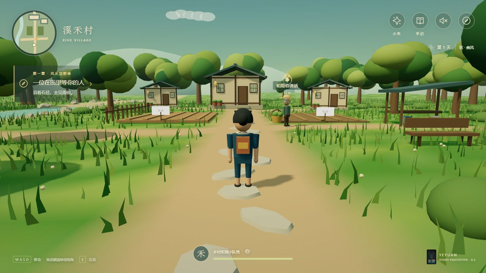

# 溪禾手记 · 风从田野来

面向中小学生的数字农业叙事游戏。玩家以乡村实践学生的身份进入溪禾村，与老农周伯共同种植一季蔬菜，通过观察、取样、小范围试验和雨后判断，探究两侧菜畦长势不均的原因。

**本仓库以 v0.2.0 可玩 Demo 作为共创起点。** 正在开发的 v0.3 探索体验升级尚未并入这里。当前是原创程序化 3D 原型，美术、角色动画和演出精度尚未达到《原神》的成品水平。



## 运行

**直接试玩：** [进入溪禾村](https://bainuoxi717-source.github.io/xihe-farm/)。这是浏览器游戏，无需登录；首次加载后点击进入。当前稳定入口为 v0.2。

**下载与改造：** 仓库已公开，无需邀请。点击 **Code → Download ZIP** 下载当前代码；也可以先 **Fork** 到自己的账号再修改。固定版本保存在 [Releases](https://github.com/bainuoxi717-source/xihe-farm/releases)。

推荐使用 Node.js 18 或更新版本。在项目目录运行：

```sh
node server.cjs
```

打开 <http://127.0.0.1:4177/>。也可运行 `npm start`。已提交可运行的 `dist`，**只试玩无需安装依赖、登录或配置 API**；服务器只监听本机，浏览器需支持 WebGL 2。

Windows 的 `启动游戏.cmd` 可尝试直接打开成品 HTML，但自动化浏览器未验证文件协议；本机 HTTP 预览是已实际试玩的方式。不同地址的浏览器存档互不通用。

## 怎么玩

- WASD / 方向键移动，Shift 快走；按住画面拖动镜头，滚轮调整距离。
- 靠近人物或物品按 E；点击场景标记或故事目标可自动走近。
- Q 打开小禾 AI，J 打开田间手记。
- 窄屏提供虚拟摇杆；默认静音，可开启本地合成环境音乐。

一季约 10–15 分钟：初遇 → 播种 → 发现异常 → 两侧取样 → 与小禾商量 → 工具棚取工具 → 小范围对照试验 → 跨日观察 → 照料 → 雨后决策 → 收菜 → 秋日饭桌与下一季的约定。试验、照料和雨后行动会改变结果；结束后仍可散步。

AI 是明确标注的**本地规则模拟**，会追问观测、比较解释、建议验证方法，并提醒玩家自己决定。它不是通用语言模型。农业数字为教学设定，不是农艺指导或预测。存档只保存在浏览器本地，手记可导出为文本；没有学生数据上传服务。

## 参与共创

先读 [协作说明](CONTRIBUTING.md)，再用 Issue 讨论故事、美术、探究设计或程序改动。任何人都可以下载或 Fork；希望贡献回本项目时提交 Pull Request。需要直接参与仓库维护的成员，由拥有者在 **Settings → Collaborators → Add people** 邀请。

建议优先验证：玩家是否想主动探索村庄、是否关心周伯、是否能把 AI 的建议转成可检验行动。暂不扩展付费服务或复杂账号系统。

## 修改与验证

修改源码时安装声明的免费开源构建依赖：

```sh
npm install
npm test
npm run check
npm run build
```

`build.cjs` 优先使用项目内的 esbuild；原开发机另有离线依赖回退路径，其他机器无需该路径。改动源码后应一并提交更新的 `dist/adventure.js`，保证下载即可试玩。

| 文件 | 职责 |
| --- | --- |
| `src/story.js` | 故事规则、模拟 AI、结果与存档 |
| `src/world.js` | 3D 场景、移动、镜头与互动点 |
| `src/main.js` | 对话、界面与玩家交互 |
| `dist/adventure.css` | 界面与响应式布局 |
| `tests/story.test.cjs` | 23 项逻辑测试，含 18 条完整分支路径 |
| `server.cjs` | 无第三方依赖的本机预览服务 |

`/__qa?width=1440`、`/__qa?width=390`、`/__qa?width=320` 提供桌面模拟尺寸检查。历史完整试玩记录见 [测试记录](测试记录.md)，本次仓库整理验证见 [共创快照验证](docs/snapshot-validation.md)。

## 限制与素材

目前只有一个村庄、一种作物、一季故事。没有专业配音或骨骼动画，导航与碰撞仍是原型；复杂绕行可能需要手动接管。尚未在真实手机或低配置设备测试，也未进行学生试玩和真实农艺验证。

Three.js r170 使用 MIT 许可，原许可保存在 [THREE-LICENSE.txt](dist/vendor/THREE-LICENSE.txt)。场景和角色为原创程序化原型；冶愿科技 Logo 来自项目拥有者提供的品牌原图副本，保持原比例与文字，自托管于 `dist/brand/`。

项目源代码与项目文档使用 [MIT 许可](LICENSE)，可在保留许可声明的前提下修改、分发和使用。品牌与第三方素材范围见 [BRAND.md](BRAND.md)。没有新增付费服务或真实模型 API。
